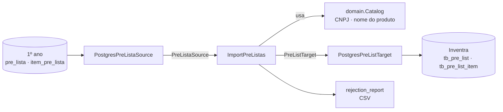

# Inventra RPA: pré-listas do 1º ano

RPA em Python que lê `pre_lista` e `item_pre_lista` do banco do 1º ano e grava no banco do Inventra, em `tb_pre_list` e `tb_pre_list_item`. Não mexe em `tb_requisition`, estoque nem em nenhuma outra tabela.

## Arquitetura

Camadas com dependência em um só sentido: `infrastructure` → `application` → `domain`. O caso de uso só conhece as portas (interfaces), então é testado com fakes, sem banco.

```
src/rpa_pre_lista/
├── domain/                           regras puras, sem I/O
│   ├── models.py                     PreLista, SourceItem, ResolvedItem, Rejection
│   └── catalog.py                    traduz fornecedor/produto do 1º ano para ids do Inventra
├── application/
│   ├── ports.py                      PreListaSource e PreListTarget (Protocols)
│   ├── import_pre_listas.py          caso de uso: orquestra leitura, resolução e gravação
│   └── summary.py                    resultado da execução
├── infrastructure/                   adaptadores
│   ├── postgres_source.py            lê o banco do 1º ano (streaming, somente leitura)
│   ├── postgres_pre_list_target.py   grava no Inventra (transação por pré-lista, lock)
│   └── rejection_report.py           CSV dos itens rejeitados
├── config.py                         variáveis de ambiente → Settings validadas
├── errors.py                         exceções da aplicação
└── cli.py                            composition root: liga adaptadores ao caso de uso
```



## Mapeamento

| Origem (1º ano) | Destino (Inventra) |
|---|---|
| `pre_lista.id_pre_lista` | `tb_pre_list.id_source` (único; controla a duplicidade) |
| `pre_lista.dt_lista` | `tb_pre_list.list_date` |
| `item_pre_lista` | `tb_pre_list_item` (uma linha por item) |
| `fornecedor.cnpj` | `tb_supplier.cnpj` (só dígitos) → `tb_pre_list_item.id_supplier` |
| `produto.nome` | `tb_product.name` (sem acento, caixa ou espaços duplicados) → `id_product` |
| `item_pre_lista.qtd` | `tb_pre_list_item.quantity` |

Nome de produto repetido no Inventra é desempatado pelo vínculo em `tb_product_supplier`; se continuar ambíguo, o item é rejeitado. Fornecedores e produtos precisam existir no Inventra: o RPA não os cria.

As tabelas vêm da migration `V016__pre_list.sql` do repositório `inventra-database-2`, que precisa estar aplicada no destino.

## Comportamento

- **Idempotente:** o id da pré-lista de origem fica em `tb_pre_list.id_source`, que é `UNIQUE`. Reexecutar só importa o que é novo.
- **Tudo ou nada por pré-lista:** se algum item não casar, a pré-lista é ignorada e os itens vão para `reports/rejeitados_*.csv`. Com `--allow-partial`, ela é importada só com os itens válidos; como `id_source` marca a lista como importada, os itens rejeitados não são reprocessados, então vale resolvê-los pelo CSV.
- **Eficiente:** a origem é lida por cursor server-side em lotes (`RPA_FETCH_SIZE`); o catálogo do Inventra é carregado uma vez; cada pré-lista é gravada em lote numa transação.
- **Seguro:** origem em `read_only`; advisory lock contra execuções simultâneas; pré-lista com erro de integridade é revertida sem afetar as demais.

## Executar

```bash
python -m venv .venv
.venv/Scripts/pip install -e .            # Linux/macOS: .venv/bin/pip
cp .env.example .env                      # preencha as credenciais dos dois bancos
rpa-pre-lista --dry-run                   # simula e desfaz no final
rpa-pre-lista                             # carga real
```

| Opção | Efeito |
|---|---|
| `--dry-run` | Executa tudo e desfaz a gravação (consome ids da sequência) |
| `--since AAAA-MM-DD` | Só pré-listas desta data em diante |
| `--limit N` | No máximo N pré-listas |
| `--allow-partial` | Importa a pré-lista mesmo com itens rejeitados |
| `--log-level` | `DEBUG`, `INFO` (padrão), `WARNING` ou `ERROR` |

**Códigos de saída:** `0` sucesso, `1` erro (configuração, conexão ou pré-lista que falhou), `2` concluiu com itens rejeitados.

### Agendamento diário (GitHub Actions)

O workflow [`daily-import.yml`](.github/workflows/daily-import.yml) roda o RPA **todo dia às 02:00 (Brasília)** e também sob demanda (aba **Actions → daily-import → Run workflow**, com a opção `dry_run` para só simular). O GitHub pode atrasar o início em alguns minutos, e o agendamento só roda a partir da branch `main`.

Cadastre em **Settings → Secrets and variables → Actions → New repository secret** (o repositório é público: o GitHub mascara nos logs qualquer valor guardado como secret, por isso até o host vai lá):

| Secret | Valor |
|---|---|
| `SRC_DB_HOST`, `SRC_DB_PORT`, `SRC_DB_NAME`, `SRC_DB_USER`, `SRC_DB_PASSWORD` | Banco do 1º ano (origem) |
| `DST_DB_HOST`, `DST_DB_PORT`, `DST_DB_NAME`, `DST_DB_USER`, `DST_DB_PASSWORD` | Banco do Inventra (destino) |
| `SRC_DB_SSLMODE`, `DST_DB_SSLMODE` | Opcionais; se ficarem vazios, vale `prefer`. Para banco gerenciado (ex.: Aiven), use `require` |

- **Acesso aos bancos:** os servidores do GitHub têm IPs que mudam, então os dois bancos precisam aceitar conexão externa (no Aiven, a lista de IPs permitidos). Se isso não for aceitável, rode o agendamento num servidor da equipe com a imagem Docker.
- **Resultado:** itens rejeitados não fazem o job falhar: ele termina com um aviso amarelo e o log lista cada item por id e motivo (como o repositório é público, o log nunca traz CNPJ nem nomes). Erro de conexão ou de gravação faz o job falhar, e o GitHub avisa por e-mail.
- **Pausa automática:** o GitHub desativa agendamentos de repositórios públicos sem nenhuma atividade por 60 dias. Se isso acontecer, reative em **Actions → daily-import → Enable workflow**.

### Docker

```bash
docker build -t rpa-pre-lista .
docker run --rm --env-file .env -v "$PWD/reports:/app/reports" rpa-pre-lista --dry-run
```

## Desenvolvimento

```bash
pip install -e ".[dev]"
ruff check .
pytest
```

O CI (`.github/workflows/ci.yml`) roda `ruff` e `pytest` em Python 3.11 e 3.12. A carga completa foi validada contra um PostgreSQL 16 com as migrations `V001`–`V016` do `inventra-database-2` e um fixture do 1º ano: dry-run, carga, reexecução, `--allow-partial` e restrição de unicidade.

## Limitações conhecidas

- O casamento de produto é por nome, porque o `produto` do 1º ano não tem código de barras. Nomes diferentes entre os bancos são rejeitados e aparecem no CSV.
- `tb_pre_list` não guarda cozinha, porque a origem não tem esse dado.
